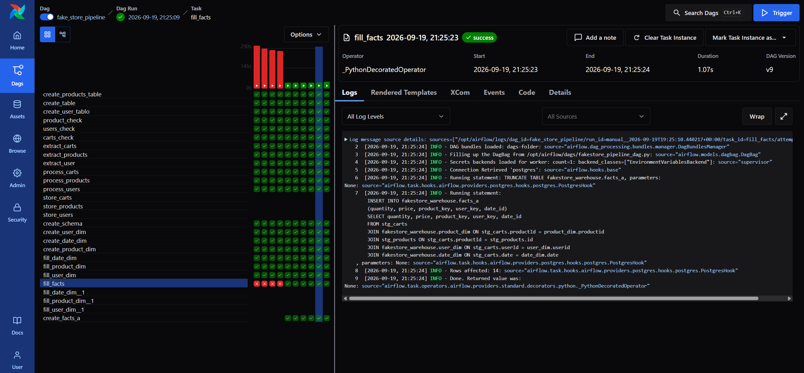

# Fake Store Data Engineering Pipeline

A batch ETL pipeline that pulls product, user and cart data from the Fake Store API, cleans and validates it with Python, and loads it into a PostgreSQL star schema. Airflow orchestrates the run, and Docker Compose runs Airflow and PostgreSQL as separate services.



---

## Pipeline Flow

```text
Fake Store API
      ↓
Apache Airflow
      ↓
Extract → Transform → Validate
      ↓
PostgreSQL Staging
      ↓
Dimensions and Fact Table
```

---

## Features

- Checks that the API is reachable before processing
- Flattens nested JSON
- Removes duplicates (by ID, and by `cart_id + product_id` for cart lines) and rejects records with missing required fields
- Keeps rejected records in `reject_table` and run metrics in `audit_table`
- Loads staging tables, then the product, user and date dimensions, then the fact table with surrogate keys
- Checks before the fact load that every cart line has a matching user and product
- Compares row counts after staging and fact loads
- Runs every load in a transaction and rolls back on failure
- Uses retries, HTTP and task timeouts, and logging

---

## Data Model

Staging tables (`public`): `stg_products`, `stg_user`, `stg_carts`

Warehouse (`fakestore_warehouse`): `product_dim`, `user_dim`, `date_dim`, `facts_a`

Operational tables (`public`): `reject_table`, `audit_table`

The pipeline uses a full-refresh loading strategy.

---

## Reliability

### Transactions

Each staging, dimension and fact load runs in a single transaction. If something fails, it rolls back and re-raises the error, so Airflow marks the task as failed and no table is left half-loaded.

### Reject handling

Records with missing required fields and duplicates are written to `reject_table` (record ID, raw data, reason, timestamp, source) instead of being dropped. This covers products, users and cart lines.

### Referential integrity

Before the fact load, a separate task looks for cart lines whose user or product has no matching dimension row. These lines are written to `reject_table` with the reason `unmatched_user` or `unmatched_product`.

### Audit

`audit_table` stores one row per source and run: timestamp, extracted, accepted and rejected counts, and status.

### Row-count checks

Accepted records are compared with the rows actually loaded into staging, and staged cart lines with loaded fact rows. A mismatch fails the task and rolls back the transaction.

### Idempotency

Repeated full-refresh runs with the same input keep the warehouse row counts stable. This check compares row counts, not row-by-row equality.

---

## Testing and CI

`tests/test_dag.py` contains five tests, run with pytest inside the Airflow container.

| Test | What it checks |
|---|---|
| `test_airflow` | The DAG file loads without import errors and `fake_store_pipeline` is registered |
| `test_duplicate` | `ayir_products` keeps one of two identical products and rejects the other as `duplicate` |
| `test_null` | `ayir_products` rejects a product with a null ID as `product_id_is_null` |
| `test_integrity` | `ayir_integrity` writes a cart line with no matching product to `reject_table` as `unmatched_product` |
| `test_rollback` | When `process_users` fails mid-load, the error is raised and `stg_user` keeps exactly its previous rows (count and content) |

### Test database setup

A session-scoped pytest fixture creates all staging, operational and warehouse tables before the tests run. It reads the `CREATE TABLE` statements from the DAG's create tasks (`dag.get_task(...).sql`) and runs them against PostgreSQL, so the test schema always matches the DAG without duplicating SQL.

Tests clean up after themselves: `test_integrity` rolls back its changes, and `test_rollback` deletes its test rows in a `finally` block.

`test_rollback` truncates `stg_user`, so the tests should only run against a disposable database, such as the one in CI.

```bash
docker compose exec airflow pytest tests/test_dag.py
```

### Continuous integration

GitHub Actions runs the tests on every push (`.github/workflows/ci.yml`):

1. Check out the repository
2. Build and start the services with Docker Compose
3. Run the tests inside the Airflow container

Each CI run starts with an empty PostgreSQL volume, so tests always run against a clean database. Credentials come from GitHub repository secrets. CI builds from the same `Dockerfile` as local development, so both use the same Airflow version.

---

## Docker Setup

The project runs two services.

`airflow` is built from the project `Dockerfile` (Airflow 3.3.2). The `./dags` and `./tests` directories are bind-mounted, so code changes don't need an image rebuild. The UI runs at `http://localhost:8082`.

`fakestore_db` runs PostgreSQL 16 with a named volume, so the data survives container recreation. Airflow reaches it at `fakestore_db:5432`, and a `pg_isready` health check makes Airflow wait until the database is ready.

---

## Configuration

Database credentials live in a local `.env` file that is not committed. The required variables are listed in `.env.example`:

- `DB_USER`
- `DB_PASSWORD`
- `DB_NAME`

In CI, the same values come from GitHub repository secrets.

The Airflow connection is defined as `AIRFLOW_CONN_POSTGRES` in `compose.yml`, so nothing has to be set up in the Airflow UI.

---

## Run Locally

```bash
git clone https://github.com/barissonmez-data/fakestore-data-engineering-pipeline.git
cd fakestore-data-engineering-pipeline
cp .env.example .env          # PowerShell: Copy-Item .env.example .env
docker compose up --build -d
docker compose ps
```

Open `http://localhost:8082` and trigger `fake_store_pipeline`.

Stop with `docker compose down`. The database stays in its named volume; only use `docker compose down -v` if you want to delete it.

---

## Validation

### Full API run

| Source | Extracted | Accepted | Rejected | Status |
|---|---:|---:|---:|---|
| users | 10 | 10 | 0 | success |
| products | 20 | 20 | 0 | success |
| carts | 14 | 14 | 0 | success |

### Row counts after the run

| Table | Rows |
|---|---:|
| `public.stg_user` | 10 |
| `public.stg_products` | 20 |
| `public.stg_carts` | 14 |
| `fakestore_warehouse.user_dim` | 10 |
| `fakestore_warehouse.product_dim` | 20 |
| `fakestore_warehouse.facts_a` | 14 |
| `fakestore_warehouse.date_dim` | 4 |

### Mock run

To test reject handling, the DAG was run with mock input containing null IDs and duplicates. For both users and products, 2 of 3 records were rejected as expected. Mock mode is controlled by `TEST_MODE` in the DAG and is off (`False`) by default.

---

## Design Decisions

- Airflow and PostgreSQL run as separate services, so orchestration stays apart from storage
- The database connection is defined in `compose.yml` instead of the Airflow UI
- PostgreSQL uses a named volume, so data survives container recreation
- `dags/` and `tests/` are bind-mounted, so changes don't need a rebuild
- Airflow waits for PostgreSQL through a health check
- CI uses the same image as local development, so tests run against the same Airflow version

---

## Limitations and Next Steps

- Airflow runs in `standalone` mode, which is meant for local development
- Loading is full-refresh; incremental loading is planned for a follow-up project
- Tests cover the validation and rollback logic, not a full end-to-end DAG run
- There is no separate test database on the server yet, so tests are meant to run in CI
- No failure notifications yet

---

## Tech Stack

- Python
- SQL
- Apache Airflow
- PostgreSQL 16
- Docker and Docker Compose
- requests
- pytest
- GitHub Actions
- Git